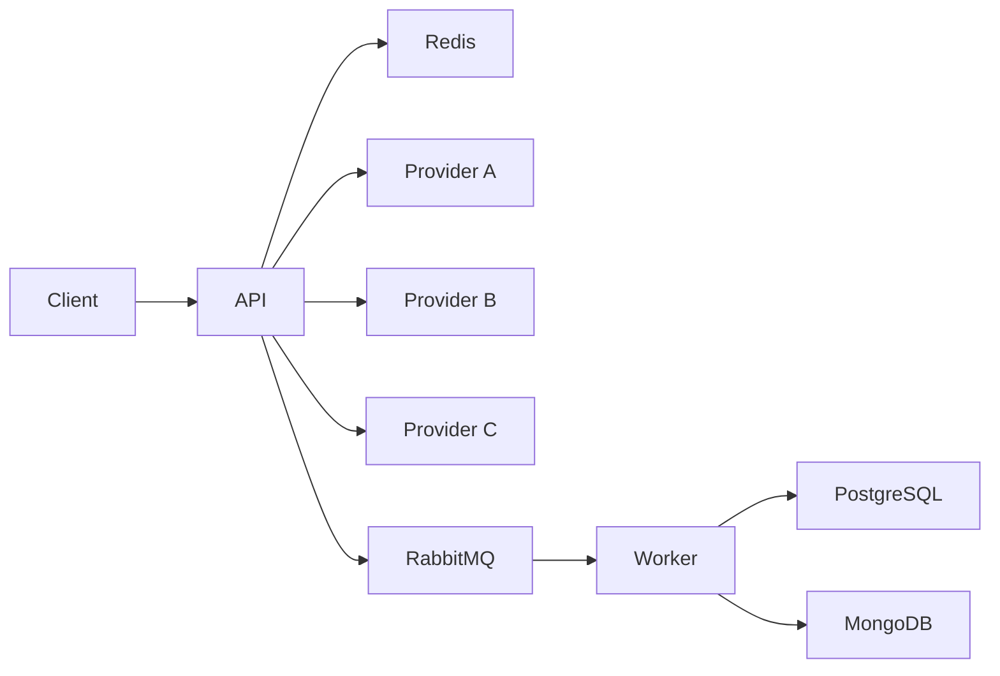

# Zohal Gateway

One synchronous `POST /v1/process` in front of three remote providers. A is preferred. A timeout, connect error, 429, 502, 503, or 504 may try one other provider inside a 3 second deadline. The audit row is not written on that path. The API publishes a message and returns. A worker inserts the narrow row in PostgreSQL and the bodies in MongoDB.

## Run

Docker is used from WSL. From the repository root:

```text
docker compose up --build -d
```

That starts Redis, PostgreSQL, RabbitMQ, MongoDB, the API on port 8000, and the worker. The Locust service is behind the `bench` profile and does not start with this command.

From WSL, against the published port:

```text
curl -sS -D - -H 'Content-Type: application/json' -H 'X-Request-ID: phase12-curl' --data '{"payload":{"order_id":"1001"}}' http://127.0.0.1:8000/v1/process
```

PowerShell strips the quotes in that JSON. Put the body in a file and pass it with `curl.exe --data-binary @body.json`.

On 2026-11-03 that returned HTTP 200, `x-request-id: phase12-curl`, provider `a`, id `txn_4ae5ab82c23b4b8f`. The provider's `latency_ms` was 380.87. The client measured 0.608 seconds. Those are different clocks.

Swagger is at http://127.0.0.1:8000/docs. RabbitMQ's management UI is at http://127.0.0.1:15672 (`zohal` / `zohal`). `/healthz` is liveness and does not call a dependency. `/readyz` checks Redis and the broker, not the providers. `/metrics` is Prometheus text.

Copy `.env.example` to `.env` if you need different provider URLs. The defaults in `app/settings.py` already match the Compose hostnames.

## Tests

The suite uses in-memory fakes. It does not call the providers. It runs in the local virtualenv, not in the image:

```text
.\.venv\Scripts\python -m pytest
```

## Shape



Redis holds A's token bucket and the idempotency records. The in-flight caps, the admission door, and the circuit breakers live in the API process. A second replica would have its own. The worker acks a message after both database writes. A repeated `trace_id` does not create a second row or a second document.

## Trade-offs

The HTTP call waits for a provider. It does not wait for PostgreSQL. That keeps a slow insert off the response, and it means a crash before RabbitMQ accepts the message can lose the audit. After the broker has the message, delivery is at-least-once. The insert is idempotent. That is not exactly-once.

One failover, not a hedge. Calling A and B together would spend two rate budgets on one caller. A 500 from a provider is returned as that provider's answer. It still counts toward the circuit breaker.

PostgreSQL stores the narrow row. MongoDB stores the bodies. They do not share a transaction. A crash between the two writes is repaired by the redelivery: the row is already there, and the document insert runs again.

The circuit breaker and the admission cap are per process. The shared limit in front of A is the Redis bucket.

## Benchmark

k6 is not installed on this machine. The generator is Locust 2.32.4 inside Compose, closed loop: each of N users sends the next request only after the previous response. Achieved RPS is not an open arrival rate. Under overload the users retry as soon as a fast 429 or 503 returns, so the request rate climbs while the success rate does not. The client timeout is 10 seconds, above the 3 second gateway deadline.

Host: Windows laptop, Docker in WSL, 8 CPUs reported by `nproc`, Docker memory limit about 19 GB. Providers are remote, so the network path is part of every latency. Gateway commit `94871f2`. Date 2026-11-03. Payload `{"payload":{"order_id":"1001"}}`. Traffic went to `http://api:8000` on the Compose network. Locust percentiles are the tool's approximated table. A 10 second warmup at 2 users was discarded. The rows below are the measured runs.

Locust's failure column is HTTP 5xx only. 429 is counted in `STATUS_COUNTS`, not in that column.

| Scenario | Users | Duration | Total RPS | Status counts | Avg / P95 / P99 ms |
|---|---|---|---|---|---|
| Under A's bucket | 2 | 30s | 2.79 | 200: 83 | 716 / 1000 / 1100 |
| Near the 10/s refill | 8 | 30s | 10.46 | 200: 304, 504: 3 | 739 / 1000 / 2500 |
| Short soak | 2 | 60s | 2.71 | 200: 161 | 735 / 1000 / 1300 |
| Past the bucket | 30 | 30s | 240.60 | 200: 338, 504: 33, 503: 2312, 429: 4441 | 121 / 480 / 1200 |

The past row's average of 121 ms is not provider latency. Most of those responses are immediate rejects. The minimum was 3 ms. The under-limit row is the one that sits in A's band: average 716 ms, P95 1000 ms, every response 200.

During the past run, `docker stats` showed the API at 117% CPU and 122 MiB, the worker at 54% CPU, Redis at 4.8% CPU. `nproc` in WSL was 8. The CPU was not full. Successes were 338 in 30 seconds, about 11 per second, next to the configured refill of 10. A's own HTTP 429 did not appear. Thirty users cannot fill the admission cap of 120, and the minimum latency was 3 ms, so the 4441 responses with status 429 are the per-caller window, not the admission door. The 33 responses with status 504 are the deadline. The 2312 responses with status 503 came back fast as well, which means the router had no eligible provider left for those calls. The first limit was the bucket.

Command, for the under-limit row:

```text
docker compose --profile bench run --rm --no-deps locust -f /mnt/locust/locustfile.py --headless --only-summary -u 2 -r 2 -t 30s --host http://api:8000
```

Change `-u` and `-t` for the other rows. Read one row as: total RPS is every response, including rejects; the status counts say how many of those were provider successes; P95 on the under-limit row is provider time, and P95 on the past row is mostly the shed path.

## Toward 1,000–10,000 RPS

Little's Law, using the under-limit measurement: concurrency ≈ 2.79 RPS × 0.72 s ≈ 2, which is the user count we set. At the same latency, 1,000 RPS wants about 720 calls in flight, and 10,000 wants about 7,200. This process admits 120, so one replica sheds well before that, around `120 / 0.72 ≈ 170` RPS even if the provider were that fast. It is not. A's bucket, as configured, passes about 10 new calls per second for the whole fleet.

Nothing here measured 10,000 RPS, and nothing here measured a stub provider. More replicas raise the admission ceiling and do not raise A's shared bucket. A higher target with these providers means a different contract: accept the call, do the provider work off the request, and let the caller poll. That is a product change, not a bigger pool.
